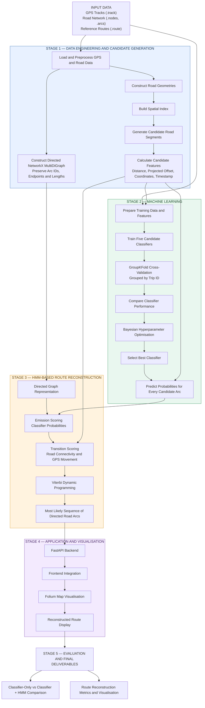

# PathSnap
### Distributed Map-Matching & Route Reconstruction Using Machine Learning

## 1. Problem Statement

GPS-based vehicle tracking systems frequently produce inaccurate and noisy location observations due to GPS measurement errors, signal interference, urban environments, and irregular sampling intervals.

As a result, recorded GPS coordinates may not accurately represent the actual road segments travelled by a vehicle. A GPS observation may appear on a nearby parallel road, outside the road network, or at an incorrect position.

Traditional nearest-road matching approaches independently assign each GPS observation to its geographically closest road segment. However, the closest road is not necessarily the road actually travelled. Such approaches can produce disconnected routes, unrealistic turns, and incorrect road assignments.

**PathSnap aims to address this problem by developing a machine-learning-based map-matching system that reconstructs the most likely sequence of directed road segments travelled by a vehicle from noisy GPS trajectories and an underlying road network.**

The system combines candidate road-segment generation, machine learning-based candidate relevance estimation, and Hidden Markov Model (HMM)-based sequence decoding to produce geographically and topologically plausible route reconstructions.

The primary objective is to improve route reconstruction by considering both the relevance of individual road candidates to GPS observations and the feasibility of movement between consecutive road segments.

---

## 2. Project Objectives

- Process noisy and irregular GPS trajectories.
- Represent the underlying road network as a directed graph.
- Identify multiple candidate road segments for each GPS observation.
- Extract relevant spatial and movement-related features.
- Train and compare five machine learning classifiers for candidate relevance estimation.
- Perform GroupKFold cross-validation to avoid trip-level data leakage.
- Apply Bayesian Hyperparameter Optimisation for model tuning.
- Implement an HMM-based decoder combining emission and transition scores.
- Use the Viterbi algorithm to identify the most likely sequence of road segments.
- Compare classifier-only predictions against classifier + HMM route reconstruction.
- Provide route visualisation through an interactive map interface.

---

## 3. Understanding the Map-Matching Problem

The system receives two primary sources of information:

### 3.1 GPS Trajectories

GPS observations are obtained from `.track` files.

Each observation contains:

- Longitude
- Latitude
- Timestamp

These observations represent the recorded positions of a moving vehicle over time.

However, GPS coordinates may contain positional errors and may not lie exactly on the actual road travelled.

### 3.2 Road Network

The road network is represented using:

| Dataset File | Description |
|---|---|
| `.nodes` | Contains road-network node coordinates. |
| `.arcs` | Contains directed connections between road-network nodes. |
| `.route` | Contains the reference sequence of road arc IDs for a trip. |

Each directed road segment is identified using its original zero-based row index from the `.arcs` file.

The road network preserves directionality, meaning that travelling from node A to node B does not automatically imply that travelling from B to A is permitted.

### 3.3 Core Challenge

For a given GPS observation, multiple nearby road segments may be plausible candidates.

The geographically closest candidate may not be the correct one.

Therefore, PathSnap does not independently select the nearest road for every GPS point. Instead, it considers:

1. How closely a candidate road matches the GPS observation.
2. Whether movement from the previous candidate to the current candidate is feasible.
3. Whether the complete sequence forms a plausible route through the directed road network.

---

## 4. System Architecture and Workflow

PathSnap follows a multi-stage pipeline combining data engineering, machine learning, probabilistic sequence decoding, and application development.

---

## 5. Detailed Working of the System

### Stage 1: Data Engineering and Candidate Generation

**Responsible: Shayna Zaidi Gupta**

The first stage prepares the GPS trajectories and underlying road network for map matching.

The GPS tracks and road-network files are loaded and processed to construct road geometries and a spatially searchable road network.

For each GPS observation, nearby road segments are identified as candidate arcs.

Instead of selecting only the closest road segment, multiple candidates are retained for subsequent evaluation.

The candidate-generation pipeline includes:

1. Loading and preprocessing GPS tracks, nodes and arcs.
2. Constructing road geometries from road-network coordinates.
3. Calculating the length of each directed road segment in metres.
4. Building a spatial index for efficient nearby-road searches.
5. Generating candidate road segments for every GPS observation.
6. Calculating the perpendicular distance between GPS observations and candidate roads.
7. Calculating the projected position along each candidate road segment.
8. Constructing a directed NetworkX `MultiDiGraph`.

The candidate DataFrame will contain:

| Attribute | Description |
|---|---|
| `trip_id` | Unique identifier of the trip. |
| `obs_idx` | Original zero-based GPS observation index. |
| `timestamp` | GPS observation timestamp. |
| `longitude` | GPS longitude. |
| `latitude` | GPS latitude. |
| `candidate_arc_id` | Original zero-based road arc ID. |
| `distance_m` | Perpendicular distance from GPS point to candidate road. |
| `projected_offset_m` | Distance along the directed road arc from its starting node to the projected GPS position. |

The road graph retains:

- Original arc IDs.
- Starting and ending node IDs.
- Directed connectivity.
- Road-segment lengths.

A NetworkX `MultiDiGraph` is used to preserve multiple directed road segments between the same pair of nodes without losing their individual identities.

### Stage 2: Machine Learning-Based Candidate Relevance Estimation

**Responsible: Sangadala Yeasaswani**

After candidate generation, the system must estimate how relevant each candidate road segment is to its corresponding GPS observation.

Five machine learning classifiers will be trained and compared:

1. Logistic Regression
2. K-Nearest Neighbours (KNN)
3. Decision Tree
4. Random Forest
5. HistGradientBoosting

The models use candidate-level features to estimate the relevance of each candidate road segment.

The training workflow includes:

- Feature preparation and preprocessing.
- Training five candidate classifiers.
- GroupKFold cross-validation using trip IDs as groups.
- Performance comparison using appropriate classification metrics.
- Bayesian Hyperparameter Optimisation of the selected model.
- Final model evaluation and artifact export.

**Hyperparameter optimisation requirement:**

Bayesian Hyperparameter Optimisation is mandatory. Grid Search and Random Search are not used.

Model training, cross-validation and hyperparameter optimisation are primarily performed using Google Colab.

The trained classifier produces a probability for every candidate road segment rather than returning only the highest-ranked candidate.

The prediction interface is:

`predict_candidates(candidate_df)`

The output DataFrame contains:

- `trip_id`
- `obs_idx`
- `candidate_arc_id`
- `probability`

Probabilities are normalised across the candidates belonging to each GPS observation.

These probabilities are subsequently supplied to the HMM decoder.

### Stage 3: Hidden Markov Model-Based Route Reconstruction

**Responsible: Shreya Shenoy**

The HMM decoder is responsible for reconstructing the most likely sequence of road segments using classifier probabilities and road-network movement information.

The actual road segment occupied by the vehicle at each observation is treated as a hidden state, while GPS coordinates and timestamps represent the observations.

The decoder consists of four major components.

#### 3.1 Directed Graph Representation — `graph.py`

The directed graph represents the road network using nodes and directed arcs.

It provides:

- Node and arc representation.
- Outgoing arc retrieval.
- Arc endpoint lookup.
- Direction-sensitive connectivity checks.
- Original arc ID preservation.

This representation establishes the graph foundation used by the decoder.

#### 3.2 Emission Scoring — `emissions.py`

Emission scoring measures how well a candidate road segment corresponds to a particular GPS observation.

The classifier provides candidate probabilities:

`P(candidate_arc | GPS_observation)`

These probabilities are converted into logarithmic emission scores:

\[
E_t(s)=\log P(s\mid x_t)
\]

where:

- \(x_t\) represents the GPS observation at time \(t\).
- \(s\) represents a candidate road-segment state.
- \(E_t(s)\) represents its emission score.

Logarithmic scores allow probabilities to be combined efficiently during sequence decoding.

#### 3.3 Transition Scoring — `transitions.py`

Transition scoring evaluates whether movement from a candidate road segment at one observation to a candidate road segment at the next observation is plausible.

It considers:

- Directed road-network connectivity.
- Shortest directed paths between candidate road segments.
- Road-segment lengths.
- Projected positions along candidate arcs.
- GPS displacement between consecutive observations.
- Elapsed time between GPS observations.

The road-network distance accounts for the remaining length of the previous candidate arc, the shortest directed connecting path, and the projected position on the current candidate arc.

A transition score is calculated by comparing road-network distance with GPS displacement and applying a time-based movement plausibility penalty.

Unreachable directed paths are treated as impossible transitions.

This helps prevent the decoder from selecting disconnected or physically implausible road sequences.

#### 3.4 Viterbi Decoding — `viterbi.py`

Viterbi is the dynamic programming algorithm used to identify the most likely complete sequence of hidden road-segment states.

It combines:

- Emission scores from the classifier.
- Transition scores from the road-network movement model.

The recurrence is:

\[
V_t(s)=E_t(s)+
\max_{s'\in S_{t-1}}
\left[V_{t-1}(s')+T(s',s)\right]
\]

where:

- \(V_t(s)\) is the best score of a sequence ending at state \(s\).
- \(E_t(s)\) is the emission score.
- \(T(s',s)\) is the transition score from the previous state.
- \(S_{t-1}\) represents candidate states at the previous observation.

Backtracking is used to recover the most likely ordered sequence of road arcs.

The resulting sequence represents the reconstructed vehicle route.

### Stage 4: Backend, Frontend and Visualisation

**Responsible: Shreyash M Yadwad**

The application layer integrates the trained classifier and HMM decoder into an accessible system.

Its responsibilities include:

- Developing the FastAPI backend.
- Integrating the candidate-generation and prediction pipeline.
- Connecting classifier predictions to the HMM decoder.
- Providing frontend functionality.
- Visualising GPS observations and reconstructed routes using Folium.
- Displaying the final reconstructed road sequence on an interactive map.

### Stage 5: Evaluation and Comparison

The complete system will be evaluated using the provided reference route data.

Two approaches will be compared:

**Classifier-only approach:**

Select the highest-probability candidate road segment independently for every GPS observation.

**Classifier + HMM approach:**

Use the classifier probabilities together with directed road-network transitions and Viterbi decoding to reconstruct the most likely route sequence.

This comparison helps determine whether sequence-based decoding improves route reconstruction over independent candidate classification.

Evaluation will consider appropriate metrics such as:

- Top-1 Accuracy.
- Precision.
- Recall.
- Macro F1-score.
- Candidate Miss Rate.
- Route reconstruction accuracy.
- Route continuity.
- Inference time.

Reference routes from the training data are used for model development and evaluation. Hidden evaluator reference routes are not used during inference.

---

## 6. Team Members and Responsibilities

| SRN | Team Member | Primary Responsibility |
|---|---|---|
| PES2UG24CS465 | Shayna Zaidi Gupta | Data Engineering, Road Geometry Construction, Spatial Indexing and Candidate Generation |
| PES2UG24CS487 | Shreya Shenoy | Directed Graph Foundation, HMM Emission Scoring, Transition Scoring and Viterbi Route Reconstruction |
| PES2UG24CS493 | Shreyash M Yadwad | FastAPI Backend, Frontend Integration and Folium Visualisation |
| PES2UG24CS441 | Sangadala Yeasaswani | Machine Learning Classifiers, Model Training, Cross-Validation and Bayesian Hyperparameter Optimisation |

### Parallel Development Strategy

The project is divided into independent workstreams to enable parallel development.

- The data-engineering pipeline prepares candidate road segments and road-network information.
- The machine-learning pipeline trains classifiers and generates candidate probabilities.
- The HMM pipeline independently develops and tests the graph, emission, transition and Viterbi components.
- The application pipeline develops the backend, frontend and map visualisation.

The components are integrated through agreed data schemas and common identifiers.

---

## 7. Technology Stack

| Category | Technologies |
|---|---|
| Programming Language | Python |
| Data Processing | Pandas, NumPy |
| Geospatial Processing | GeoPandas, Shapely |
| Spatial Indexing | Spatial indexing libraries |
| Road Network Representation | NetworkX MultiDiGraph |
| Machine Learning | Scikit-learn |
| Hyperparameter Optimisation | Bayesian Optimisation |
| Model Training Environment | Google Colab |
| Sequence Decoding | Hidden Markov Model, Viterbi Algorithm |
| Shortest-Path Algorithms | Directed Dijkstra |
| Backend | FastAPI |
| Visualisation | Folium |
| Version Control | Git and GitHub |

---

## 8. Expected Outcome

PathSnap aims to provide an end-to-end map-matching system that transforms noisy GPS trajectories into plausible sequences of directed road segments.

By combining machine learning-based candidate relevance estimation with HMM-based sequence decoding, the system seeks to improve route reconstruction beyond independent nearest-road or highest-probability candidate selection.

The final application will provide reconstructed route sequences and map-based visualisations, supported by quantitative evaluation against reference trajectories.

